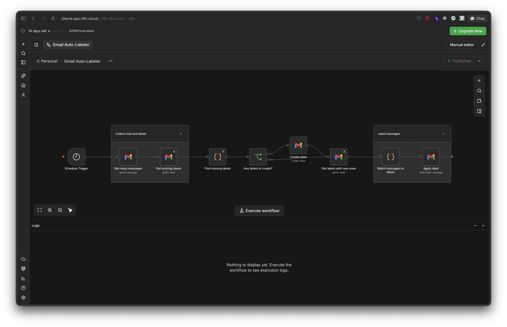

# gmail-auto-labeler

n8n workflow. Runs weekly and labels Gmail messages by sender domain.
Free-mail providers are skipped. Missing labels are created first, then
applied to matching messages.



> **NOTE:** My personal n8n learning project, not production software. Each
> run does a full `returnAll` scan of the mailbox, so reuse the labeling
> pattern, not the deployment. Add pagination, quota handling, and rate limits
> before pointing this at a real inbox.

## Import

Import `workflows/gmail-auto-labeler.json` through the UI (Workflows >
Import from File) or:

```bash
n8n import:workflow --input workflows/gmail-auto-labeler.json
```

Exports contain references to credentials, not the credentials themselves.
Self-hosted n8n has no managed Google OAuth client, so create a Gmail OAuth2
credential first: enable the Gmail API in Google Cloud Console, add an OAuth
client of type "Web application", set the redirect URI to
`<n8n-url>/rest/oauth2-credential/callback`, and name the credential
`Gmail account`. Do this before importing, or reselect it on the five Gmail
nodes after. Imports arrive inactive.

Schedule is Monday 18:00 in the instance timezone (default America/New_York).
Set `GENERIC_TIMEZONE` or the workflow timezone.
